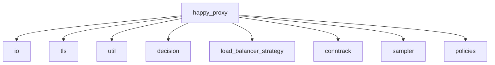

Happy proxy is an open source a c++ implementation of HAPROXY.

It supports HAPROXY configuration files, addons and balance strategies with additional 
Filtering,automated policies and error prediction /caching capabilities. 

The implementation relies on built-in iptables netfilters instead of asynchronous I/O 
This memory operations and os operations on the service level. 

For compatability reasons, we also support non-privileged execution , using asynchonous I/O proactor pattern, timers are set to collect and notify events. libevent /libeventhttp are also supported. 

Load balancing configuration and settings can be imported from HAPROXY

Enabling dynamic optimizations will add additional inspection of vectorized fields, ingress ssl sessions can be treated transparently or inspected via standard settings 

Additional ACL policies enabled for access restriction 
Authorization model and commercial enterprise features are supported via dynamic linkage. 

structure :  

Contact us : info@provallo.com

Made with <3 in San Francisco

